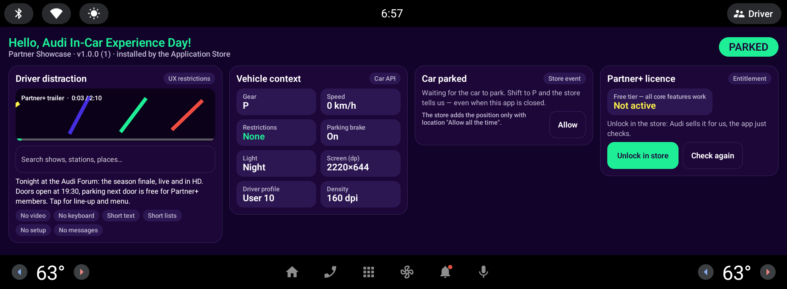
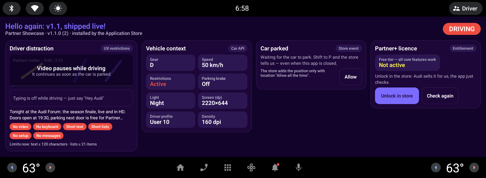

# Partner Showcase: an Android Automotive sample app

What a car app can do that a phone app can't, in one small project. Shown live at the
**Audi In-Car Experience Day 2026**.

| Parked | Driving |
|---|---|
|  |  |

## What's inside

- **Driver distraction.** The app follows the car's UX restrictions live. Video pauses, the
  keyboard closes and long text gets shorter while the car moves; everything continues when parked
  (`CarUxRestrictionsManager`, `distractionOptimized`).
- **Audio focus.** The app asks before it plays. It pauses for the assistant or a call, ducks
  for prompts, and never grabs the focus back (`AudioFocusRequest`).
- **Internet behaviour.** A network listener instead of assumptions. Offline, the app says so
  and keeps showing what it has (`ConnectivityManager`).
- **Vehicle context.** Gear, speed, parking brake and day/night, read through the Car API
  (`CarPropertyManager`), plus a list of **every vehicle signal (VHAL property)** the app's
  permissions let it read. The list is only available while parked.
- **Store events.** In Audi vehicles, the Application Store tells partner apps when the car is
  parked. The app offers to start a parking session, and the store shows that offer as a
  notification on its behalf.
- **Licence check.** A licence sold by the car's store, checked on the device. On the emulator
  this is simulated, with the same API shape as the store's Entitlement SDK.

## Run it

1. In Android Studio, open **Device Manager**, create a device, choose **Automotive**, and pick
   an Android Automotive system image (API 33 or newer).
2. Build and install (JDK 17, Android SDK platform 37):
   ```powershell
   .\scripts\build-install.ps1        # or: cd demo-app; .\gradlew installDebug
   ```
3. Drive the car from your laptop:
   ```powershell
   .\scripts\drive.ps1               # gear D, 50 km/h: the car restricts, the app adapts
   .\scripts\park.ps1                # gear P, and the "car parked" event
   .\scripts\audio.ps1               # the assistant speaks: the trailer pauses
   .\scripts\offline.ps1             # a tunnel; -Back to come out again
   .\scripts\licence.ps1             # the store grants the licence
   ```
   The scripts use `adb shell cmd car_service inject-vhal-event`, which works on any Android
   Automotive emulator.

## Store identifiers are placeholders

The in-car Application Store's action names, permissions and package names appear here as
placeholders (`com.example.carstore…`): the "car parked" event, the store's notification on the
app's behalf, and the licence check. Partners get the real identifiers with the partner
agreement; the code paths stay exactly the same. On the emulator, `park.ps1` and `licence.ps1`
simulate the store.

To publish in Audi vehicles, talk to us. The partner programme covers onboarding, testing on
real hardware, certification and publishing.

## License

Apache License 2.0. This is sample code, not an SDK, and comes without support or guarantees.
